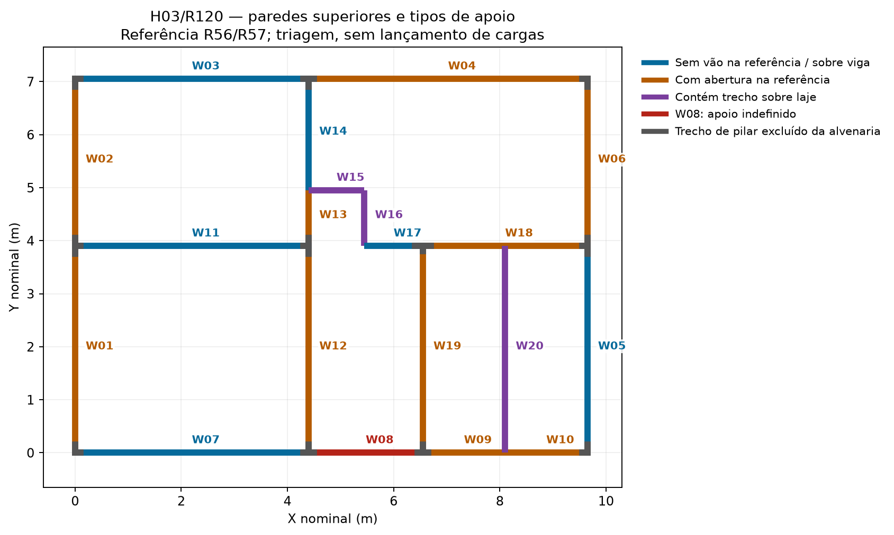

# H03/R120 — matriz das paredes superiores para preparar o lançamento pareado

Organizou-se a referência de vinte paredes em 59 trechos, com pontos em planta, intervalos, nomes dos receptores e magnitudes gravitacionais da composição hipotética R55/R97: parede acabada de 15 cm, corpo cerâmico de 11,5 cm e argamassa de 1,75 cm por face, resultando em 1,565 kN/m² de parede. A composição não foi aferida por fabricante ou ensaio. As fontes e seus hashes estão no JSON. A geometria continua sendo a exportada R56, cuja preservação foi conferida na R57; **não se realizou nova exportação dos modelos atuais nesta revisão**.

Dos 59 trechos, 29 representam regiões de pilares excluídas da alvenaria, 26 apresentam contato geométrico com vigas, três estão sobre lajes e um corresponde à fachada W08 sem apoio definido no N1. Em quatro trechos dos encontros W12/W19, a interseção de caixas retornava duas vigas. Priorizou-se a viga paralela à parede, com correspondência CAD/BIM por caixa espacial. Essa escolha organiza o roteiro; não comprova vínculo analítico nem partilha de reações. Os contatos com vigas transversais nos extremos das paredes sobre laje permanecem explicitamente pendentes.

Identificaram-se seis faixas sem abertura cadastrada e apoiadas geometricamente em viga paralela, para priorizar a futura conferência nativa:

| Parede | Pontos extremos X/Y (m) | CAD / BIM | Magnitude linear (kN/m) | Magnitude da parcela (kN) |
| --- | --- | --- | ---: | ---: |
| W03 | (0,10; 7,05) → (4,30; 7,05) | V3 / V1 | 4,44460 | 18,66732 |
| W05 | (9,65; 0,15) → (9,65; 3,75) | V8 / V12 | 4,46025 | 16,05690 |
| W07 | (0,10; 0,00) → (4,30; 0,00) | V1 / V5 | 4,44460 | 18,66732 |
| W11 | (0,10; 3,90) → (4,30; 3,90) | V2 / V2 | 4,44460 | 18,66732 |
| W14 | (4,40; 4,95) → (4,40; 6,90) | V11 / V10 | 4,44460 | 8,66697 |
| W17 | (5,45; 3,90) → (6,40; 3,90) | V14 / V2 | 4,44460 | 4,22237 |

O subtotal dessas seis faixas é **84,94820 kN**, sem constituir carga lançada, massa final do edifício ou subtotal das vinte paredes. Os comprimentos correspondem às faixas de alvenaria, com exclusão das regiões de pilares. W14 e W17 ocupam apenas parte do sólido de viga correspondente. O trecho de apoio W17 tem altura exportada de 16 cm, que exige conferência nativa e verificação própria; não se aprovou a seção por selecionar esse contato como candidato.

O lançamento deve preservar os intervalos exatos: aplicar a carga à viga inteira pode acrescentar peso fora da faixa. A [documentação oficial para cargas em parte da viga](https://suporte.altoqi.com.br/hc/pt-br/articles/360046158854) orienta definir nós nos limites quando eles ainda não existem. O roteiro ainda precisa conferir pontos, divisões e comportamento da versão instalada. A [orientação oficial de carga linear](https://suporte.altoqi.com.br/hc/pt-br/articles/360058309854) distingue a carga diretamente cadastrada no elemento da carga definida por dois pontos na laje. Portanto, não se presume que uma linha sobre a planta limite automaticamente a carga na viga correta.

O sinal da entrada linear não foi preenchido: os JSONs guardam magnitudes positivas e `nativeSignedInputValue=null`. A convenção de Fz nodal negativo usada no telhado não deve ser copiada para esse diálogo sem conferência de unidade e sentido. A proposta de ação é Adicional, sujeita à leitura das cargas já existentes antes de somar ou substituir. Não se alterou a biblioteca global de paredes nem se aplicou uma carga por área para substituir paredes localizadas.

As três faixas sobre laje pertencem a W15, W16 e W20. A [documentação oficial de cargas em lajes](https://suporte.altoqi.com.br/hc/pt-br/articles/115001731754) permite representar a parede por linha entre dois pontos. Isso fundamenta o recurso operacional, mas não comprova que a grelha atual, a posição, as flechas e a resistência estejam adequadas. W16 também contém abertura: a distribuição ao redor do vão permanece uma decisão de modelagem pendente.

Aplicou-se apenas à memória de massa a posição corrigida da porta S-P3-02/W18, já documentada na R68. O vão nominal passou de X9,05–9,65 para X8,873633–9,473633 m, sem deslocar a arquitetura ou o pilar. Na referência antiga, 0,10 m de sua largura coincidiam com região de pilar excluída da alvenaria. Com o vão claro corrigido, o desconto passa de 1,05 para 1,26 m². A área líquida condicional de W18 passa de 7,0725 para **6,8625 m²** e o peso correspondente é **10,7398125 kN**, diferença de −0,32865 kN. O registro R67 foi preservado. Essa correção de localização da referência não foi classificada como defeito DWG/IFC.

As demais dezoito paredes com altura conhecida conservaram as áreas condicionais da R67. Os peitoris J1 continuam desconhecidos; o desconto pressupõe encaixe vertical integral e não representa validação desse encaixe. Não se acrescentaram tara de esquadrias, vergas/contravergas ou acabamento sobre concreto. A dedução de massa não autoriza distribuir a parede com vão uniformemente: a verga e as ombreiras alteram o caminho das ações. Não se realizou união volumétrica dos encontros de paredes nesta matriz.

W08 continua com carga nativa **desconhecida**, nunca zero. A R70 descreve a janela J4 atravessando o plano N1 e a ausência de viga nesse trecho. A área condicional daquela revisão não definiu quanto do peso chega à superestrutura nem por qual apoio; esse problema não foi resolvido por soma de áreas ou pela criação de uma viga que obstruísse a janela.

Todos os trechos permanecem com `readyForNativeApplication=false`. A matriz é um plano comum para conferir e aplicar em novas cópias independentes, não um lançamento concluído. Não houve processamento, alteração de PRJ/RVT/DWG, modificação da arquitetura ou edição da monografia. Os dois testes verificam as fontes reais, o desconto corrigido de W18, a preservação das lacunas e a rejeição de abertura duplicada ou apoio CAD/BIM incompatível. O tempo registrado mede somente execução do script e geração da figura, excluindo autoria, pesquisa e revisão; não entra como tempo de desenvolvimento de um dos fluxos.

Arquivos em `D:/TCC/outputs/Paredes-H03-R120-MATRIZ-NAO-APLICADO/`. Próxima operação: conferir no Eberick uma faixa prioritária e as cargas existentes, validar sinal/unidade/extensão, aplicar em cópias pareadas e reler após salvar/reabrir. A aplicação deve registrar o tempo e as ações efetivas de cada ramo. Reservatório, demais paredes, escada, vento, combinações e verificações completas permanecem abertos.
