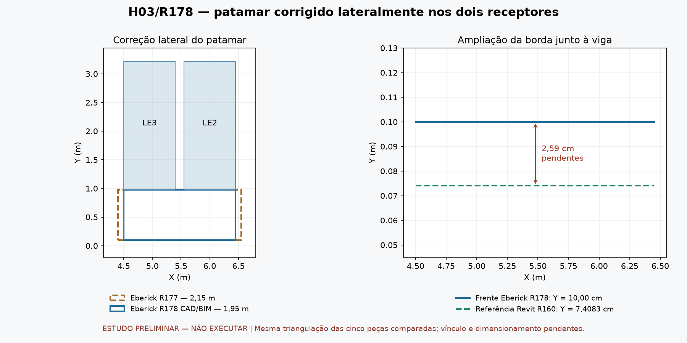

# H03/R178 — correção lateral do patamar nos receptores CAD e BIM

**Estudo preliminar — não executar.** A revisão corrige a largura do patamar LE1 em duas cópias independentes do Eberick. Não encerra a compatibilização da escada, a verificação normativa ou o dimensionamento. Os arquivos do Revit e do AutoCAD de origem permanecem nas revisões anteriores; o trabalho desta etapa ocorreu nos receptores Eberick.

## Procedimento efetivamente realizado

Preservou-se a R177 e criou-se uma cópia R178 de cada receptor. No nível intermediário de altura 157,4 cm, excluiu-se somente o patamar LE1. Lançou-se uma barra comum de largura zero em X = 450 cm e outra em X = 645 cm, de Y = 0 a 97,578333 cm, e relançou-se LE1 dentro desse contorno. Manteve-se a escada E1, espessura preliminar de 14 cm, elevação zero, carga acidental de 2,5 kN/m² e revestimento provisório de 1,0 kN/m². A carga de acabamento, guarda-corpos e cargas concentradas continuam pendentes de conferência.

Essas barras são recursos do modelo analítico, sem a criação de novas vigas físicas. Não se acrescentou pilar físico. Manteve-se V16 entre as posições existentes e preservou-se a hipótese anterior dos apoios inferiores idealizados AE1A e AE1B. As barras externas antigas ainda permanecem na cópia experimental e exigem revisão do seu efeito no modelo; a correção geométrica isolada não comprova a adequação do esquema resistente.

Salvou-se o modelo, exportou-se um IFC4 de cada receptor e processou-se análise estática linear com determinação dos deslocamentos do pórtico pela rigidez configurada. O dimensionamento dos elementos, a verificação de flechas das lajes e a análise dinâmica permaneceram desmarcados. Emitiu-se o relatório nativo de mensagens e exportou-se o pórtico, as grelhas das lajes N1/N2 e a grelha da escada em formato textual SAP2000. **O SAP2000 não foi executado.** A cópia CAD foi fechada e reaberta antes da exportação analítica final.

## Geometria e qualidade da informação

O patamar exportado passou de X = 4,40–6,55 m para X = 4,50–6,45 m, corrigindo a largura de 2,15 m para 1,95 m. Em ambos os receptores, a leitura IFC de LE1 indica Y = 0,1000–0,9758 m e Z = 1,634–1,774 m. A borda dianteira ainda difere aproximadamente 2,59 cm da referência física Revit R160, situada em Y = 0,074083333 m. Portanto, a largura foi corrigida, mas o contorno completo não foi considerado reconciliado.

Comparou-se o multiconjunto dos triângulos em coordenadas globais de LE1, LE2, LE3, AE1A e AE1B, arredondando as coordenadas a sete casas decimais em metros. A triangulação dessas cinco peças coincide entre as duas exportações. A precisão de comparação é computacional, não uma tolerância de fabricação, execução ou aceitação normativa. Não se estendeu essa conclusão à triangulação de todos os demais elementos do edifício.

As exportações contêm 48 IfcBeam, 22 IfcColumn, 13 IfcFooting, 12 IfcSlab e dois IfcStairFlight em cada receptor. A representação dos apoios por IfcFooting não constitui dimensionamento de fundação: o estudo continua limitado à superestrutura e os marcadores são hipóteses numéricas.

Mantiveram-se nove espelhos no lance inferior e oito no superior. A auditoria de acabamento continua identificando primeiro espelho de 17,800 cm e demais de 17,825 cm, diante da meta exata de 17,823529 cm. O teste interno de uniformidade com tolerância de 0,020 cm continua reprovado. Essa tolerância não foi apresentada como limite normativo. A compatibilização da base e dos acabamentos, incluindo a diferença original de 3 cm, não foi encerrada.

Os atributos IFC NumberOfRisers e NumberOfTreads continuam zerados e RiserHeight/TreadLength vazios. A contagem de espelhos foi obtida diretamente da geometria. Isso constitui uma perda de informação semântica relevante para a análise do intercâmbio, ainda que a geometria esteja presente.

## Comparação analítica após a correção

| Exportação por receptor | Nós | Barras |
| --- | ---: | ---: |
| Pórtico | 137 | 172 |
| Grelha da escada | 284 | 375 |
| Grelha da laje N1 | 469 | 840 |
| Grelha da laje N2 | 443 | 794 |

Nos quatro pares, coincidem os multiconjuntos de coordenadas, os segmentos sem considerar o sentido I–J e as propriedades de seção por segmento. As tabelas de restrições nodais também coincidem depois de identificar os nós por posição. O pórtico passou de 135 nós/170 barras na R177 para 137/172 na R178. Essa alteração deve ser considerada ao discutir o efeito das bordas adicionadas.

Persistem diferenças na orientação I–J e nas tabelas de cargas de barras. A tabela de cargas nodais apresenta 16 registros diferentes no pórtico e nove na grelha N2; não há diferenças nodais nas grelhas da escada e N1. A auditoria conserva os valores e as posições de cada diferença no JSON, sem eliminar resíduos por uma tolerância escolhida posteriormente. A conversão de cargas para uma referência comum continua pendente. Não se declarou equivalência mecânica integral.

Nos dois resumos nativos, a análise parcial apresentou peso próprio de 78,93 tf, adicional de 12,58 tf, acidental de 18,45 tf e Q_TELHADO_MANUTENCAO de 1,78 tf, total de 111,74 tf e área aproximada de 138,18 m². O programa manteve o aviso de relação de carga por área não usual. Os relatórios de precisão registram ausência de diferenças numéricas encontradas na verificação executada. A solução numérica e esses valores não representam aprovação estrutural; a justificativa física dos vínculos inferiores, ELS e detalhamento continuam pendentes.

## Tempos e esforço de correção

| Registro desta revisão | CAD | BIM | Interpretação |
| --- | --- | --- | --- |
| Tempo nativo total da análise parcial | 5 s | 6 s | Uma execução documentada por receptor, com resolução de segundos |
| Intervalo observado entre início registrado e primeiro salvamento | 1 min 7,176 s | 8 min 52,704 s | Intervalos operacionais parciais; não representam tempo ativo ou total de fluxo |
| Correção local aplicada | Um patamar relançado e duas barras comuns | Um patamar relançado e duas barras comuns | Mesma correção geométrica nesta etapa; não é contagem total do retrabalho de importação |

O cronômetro CAD foi iniciado depois da exclusão de LE1. O registro BIM inclui essa exclusão e uma pausa entre retomadas da conversa. Além disso, o procedimento BIM foi executado depois do aprendizado no CAD. Não existe base metodológica para dividir esses intervalos ou declarar vantagem de produtividade entre os fluxos. Não se converteram pausas em tempo produtivo, nem se somaram os intervalos aos tempos finais de comparação.

A diferença de um segundo entre os tempos nativos também não classifica um fluxo como superior. A R177 havia documentado 5 s CAD/4 s BIM sob o contorno anterior; a R178 registra 5 s/6 s com a correção. São observações de revisões diferentes, sem repetição controlada suficiente. O tempo completo CAD/BIM, as intervenções humanas e o esforço da IA ainda precisam ser consolidados com fronteiras equivalentes, separando desenvolvimento das automações, operação, latência, inspeção e retrabalho.

O trabalho da IA nesta revisão compreendeu operação assistida da interface do Eberick, conferência de campos, exportações, leitura independente de IFCs e arquivos analíticos, elaboração de código de auditoria e documentação. Não se mediu consumo de tokens ou custo de API nesta etapa; não se deve inferi-lo da duração da conversa. Não houve chamada externa à IA pelos testes de auditoria.

## Arquivos e conferência reproduzível

As cópias nativas ficam em `D:/TCC/outputs/R178-CAD-CONTORNO-PATAMAR-NAO-EXECUTAR` e `D:/TCC/outputs/R178-BIM-CONTORNO-PATAMAR-NAO-EXECUTAR`. Os IFCs novos ficam em `Arquivos do projeto` dessas pastas, identificados como `r178-cad-patamar-controle.IFC` e `r178-bim-patamar-controle.IFC`. Os dois relatórios, oito arquivos analíticos e o resultado `R178-comparacao-CAD-BIM.json` ficam na pasta de evidências desta revisão.

`auditar_contorno.py` lê os arquivos reais, verifica os hashes das fontes R177, a integridade ZIP dos PRJs, o conjunto de peças, o contorno, as quatro saídas por receptor, a triangulação e os registros de tempo. `visualizar_contorno.py` gera a figura com dados medidos. Os três testes locais verificam independência da ordem dos vértices, detecção de malhas diferentes com limites iguais e preservação de triângulos duplicados. Os oito testes da R177 também passaram. Esses 11 testes verificam a auditoria; não substituem verificações de engenharia dentro do Eberick.

## Próxima etapa

Reconciliar as cargas e a orientação das barras em referência comum; resolver a borda dianteira e revisar as barras externas remanescentes; conferir base, acabamentos, altura livre e interferência V16/J4; justificar o apoio inferior idealizado; concluir cargas, dimensionamento, ELS e detalhamento; consolidar os tempos e o retrabalho dos dois fluxos. A monografia não foi modificada nesta revisão.
