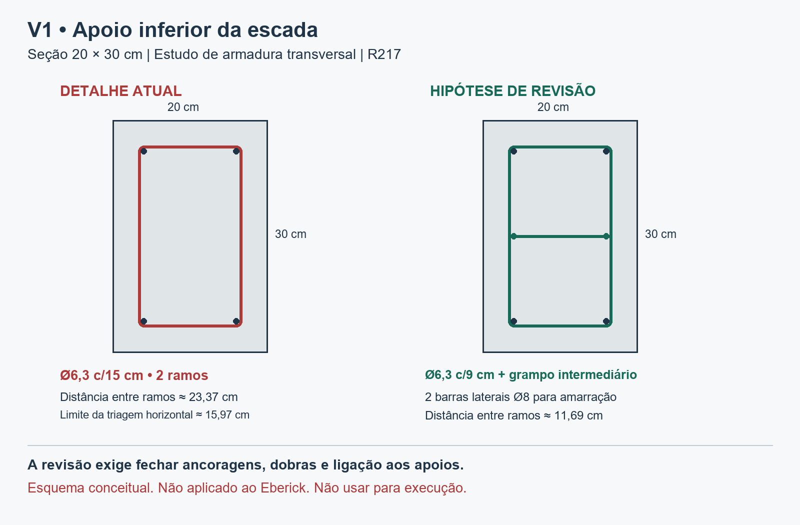

# R217 — Verificação complementar da V1 do N0

Registro de 2026-11-04T22:37:20.491241+00:00. Estudo acadêmico limitado à superestrutura.

## Conclusão da conferência atual

O detalhamento existente não atende à triagem transversal nas duas direções adotada neste estudo. A viga permanece com Aviso 19 no Eberick e a verificação estrutural integral não está concluída. O ensaio complementar indica capacidade de flexão suficiente na seção 20 × 30 cm, sob suas hipóteses, mas não permite dispensar a revisão de estribos, ancoragens, nós e apoios. Não se alterou a seção, a armadura ou os arquivos PRJ nesta revisão. A imagem propõe uma solução transversal para desenvolvimento, sem constituir detalhamento executivo.



## Evidência nativa e rastreabilidade

Conferiu-se a V1 em detalhe no Eberick. O desenho mostra vão livre de 70 cm, comprimento total de 110 cm, dois apoios de 20 cm, seção 20 × 30 cm, duas barras superiores Ø8 com ganchos indicados de 27 cm, duas inferiores Ø8 retas de 104 cm e oito estribos Ø6,3 c/15 cm. A extensão analítica entre nós extremos da V1 é de 88 cm.

Emitiram-se relatórios nativos de combinações nos dois fluxos. Cada relatório contém 87 tabelas, sendo 19 casos e 68 combinações. A comparação célula a célula dos 14 campos numéricos não encontrou diferença na precisão impressa. O relatório BIM foi emitido da cópia R216 e preservado na raiz da R217; o CAD foi emitido da cópia CAD R217, proveniente da R214. A consulta nativa CAD desta revisão não alterou seu PRJ.

| Arquivo-base | SHA-256 |
|---|---|
| PRJ CAD consultado | 1bb22b8316417a11f53d9506483910593aad11f26d8db2548c72c969d651ca53 |
| PRJ BIM consultado | 84ce9482e16afdeac95c3301fbbae63c52dc2555e069c3c7b4a239b0618348b2 |
| Relatório CAD | 14042551120c04eb121dc8403a485264ac15deeef6a6581d3bbb55a59eba62f4 |
| Relatório BIM | 11f34041a25ae61e8fea142705689ac001867195457c71fa9e8084da748cc893 |
| Grelha CAD R214 | 4b1b7eb28396594c2eafba6d2bcb003f9ec0b3bbb15e8cbe7357f425c2e4d40f |
| Grelha BIM R214 | 65eefadd2023619acc5c21cfac548b4b0de74abd6639d0ced80a3e9b797543c1 |

My/Vy horizontais são 0,00 nos relatórios nativos da V1. Esse registro não comprova ausência da ação lateral da escada. A documentação oficial descreve a componente horizontal omitida no dimensionamento automático como motivo do Aviso 19. Preservou-se o aviso.

## Método do ensaio complementar

Reconstruiu-se a grelha 3D de escada exportada na R214 com barras lineares de Euler–Bernoulli, seis graus de liberdade por nó, liberações condensadas, cargas uniformes e propriedades genéricas. Não se executou SAP2000. O script usa cinco segmentos da V1, entre X = 451 e 539 cm, Y = 321,58 cm e Z = 20 cm. A grelha inclui 298 nós e 389 barras. Molas artificiais com rigidez igual ou superior a 10¹⁹ foram tratadas como restrições. O solver não reproduz o ciclo de interação entre grelha e pórtico do Eberick.

As exportações declaram kgf e cm. A conversão física usa 0,00980665 kN/kgf; a escala nominal 0,01 reproduz mais de perto o resultado impresso. Conservou-se a escala nominal maior para solicitações, sem esconder a diferença de 1,93% entre escalas. A causa dessa convenção de exportação não foi demonstrada. A calibração vertical não comprova a exatidão horizontal. A grelha não foi reexportada após a recuperação BIM R215; a concordância dos momentos de controle reduz a incerteza, mas não comprova identidade integral do modelo recuperado.

Para G1, G2 e Q, os momentos nas duas extremidades verticais diferem do relatório em menos de 0,005 kN.m. O resíduo relativo máximo do sistema é 3.68e-06. A alternativa com deformação de cisalhamento e fator 5/6 reduz os máximos horizontais CAD de aproximadamente 1,776 para 1,632 kN.m e de 15,543 para 14,829 kN. O cálculo principal conserva os resultados maiores. Essa análise de sensibilidade não cobre toda a incerteza de modelagem.

Preservou-se cada combinação. Para uma seção constante, adotou-se uma envoltória conservadora dos módulos de M e V dentro de cada combinação, incluindo 0,005 de margem de leitura nas grandezas impressas. Esses limites podem ocorrer em posições diferentes e não são apresentados como vetor simultâneo observado. Para N, adotou-se o intervalo do relatório acrescido do módulo axial complementar. A torção reconstruída é residual numérica; o JSON registra também esse componente, sem usar o zero impresso como prova de ausência física.

## Flexão da seção

Usou-se C25, aço CA-50, γc = 1,4, γs = 1,15, Es = 210 GPa, cobrimento nominal de 30 mm, estribo de 6,3 mm e quatro barras de 8 mm nos cantos. Considerou-se o centro das barras a 40,3 mm da face e calculou-se o equilíbrio com concreto parábola-retângulo e aço elastoplástico, descontando o concreto ocupado pelo aço. O cálculo é referente ao ELU resistente da seção. Não abrange toda a verificação de ELS, durabilidade ou regiões de descontinuidade.

A interação linear Mv/MRv + Mh/MRh usa expoente 1 e as resistências uniaxiais no mesmo intervalo axial. A verificação do menor valor nos extremos do intervalo foi confrontada com amostragem interna do intervalo efetivamente estudado. O ensaio adicional com piso vertical de 8 kN.m retoma o valor mínimo observado no dimensionamento nativo. Ele é uma análise de sensibilidade e não substitui as demais regras normativas de armadura mínima, momento mínimo ou detalhamento.

| Fluxo | Índice com esforços calculados | Índice com piso vertical de 8 kN.m | Erro vertical de controle, kN.m |
|---|---:|---:|---:|
| CAD | 0.4583 | 0.9670 | 0.00464 |
| BIM | 0.4583 | 0.9670 | 0.00469 |

Combinação controladora de flexão CAD: `1.4G1+1.4G2+1.4Q+0.84V1+0.84D1+0.7QT`. Limites Mv = 2.385 kN.m e Mh = 1.781 kN.m; resistências inferiores MRv = 11.036 kN.m e MRh = 7.353 kN.m. Resultado inferior a 1 no ensaio. A margem com o piso de 8 kN.m é pequena e depende das hipóteses documentadas; não representa margem global de segurança da obra.

## Armadura transversal

Para o modelo I com bielas a 45°, a profundidade útil vertical é 259.7 mm e a horizontal é 159.7 mm. Os cortantes de envoltória são 18.475 e 15.548 kN, com VRd2 de 225.382 e 207.895 kN. A triagem conservadora soma as parcelas relativas de cada direção e fornece 0.157 para as bielas. Não se atribui à norma uma fórmula específica de interação biaxial que ela não tenha estabelecido; trata-se de critério adicional adotado neste ensaio.

Na direção horizontal, 0,6d = 95.82 mm. O espaçamento atual de 150 mm excede esse limite. A hipótese de 90 mm atende a esse critério. A distância entre os eixos dos ramos horizontais do estribo fechado é 233.7 mm, superior a d = 159.7 mm. Um grampo intermediário reduz essa distância para 116.85 mm. A amarração do grampo exige duas barras laterais, indicadas no esquema como Ø8. Essas barras adicionais não foram incluídas na resistência de flexão calculada.

Com Ø6,3 c/9 cm, ignorando a contribuição Vc e contando somente dois ramos por direção, a soma conservadora Vv/Vsw,v + Vh/Vsw,h é 0.622. Esse resultado não substitui a definição de ganchos, montagem e ancoragem do grampo. A mudança não foi aplicada ao arquivo nativo. Não é suficiente alterar apenas a legenda do desenho ou reduzir o espaçamento sem resolver a distribuição entre ramos.

## Ancoragem e ligação aos apoios

Para Ø8, boa aderência e C25, a triagem fornece fbd = 2.886 MPa, comprimento básico de 301.3 mm e mínimo de 100.0 mm. A disponibilidade geométrica nominal de uma barra reta no apoio de 20 cm com cobrimento de 3 cm é de 170 mm, antes de refinar a geometria real da ligação.

Uma triagem conservadora que concentra a soma dos cortantes das duas direções, acrescida do limite de tração axial, no par de barras fornece força de 34.381 kN. Para essa hipótese, o comprimento necessário reto é 237.0 mm; com fator 0,7 de gancho, sujeito às condições normativas, é 165.9 mm. A triagem reta não fecha com 170 mm. O valor com gancho não é uma solução pronta, pois ainda depende de distribuição por barra, curvatura, posição, cobrimento normal ao gancho, distância às bordas, conflito com as barras superiores e confinamento do nó. Não se declarou a barra existente reprovada unicamente por essa hipótese conservadora nem se liberou a alternativa com gancho pela comparação de dois comprimentos.

AE1A/AE1B continuam apoios idealizados da superestrutura. A transferência das componentes horizontais, o nó de ligação e o detalhe de continuidade precisam estar definidos. A hipótese de cobrimento de 30 mm também depende de não haver contato direto com solo, condição que não foi demonstrada nesta revisão. Não há dimensionamento de fundação.

## Testes, comparação e próximos critérios de aceitação

Dez testes automatizados controlam alongamento, torção, flexão nos dois planos, movimentos de corpo rígido, transformação de eixos, cargas uniformes, liberações, deformação de cisalhamento e equilíbrio resistente confrontado com quadratura independente. São testes do código auxiliar; não são testes de aprovação do edifício. A reexecução real comparou os relatórios nativos e as 68 combinações por fluxo. As fontes, cálculos e resultados ficam preservados.

O detalhamento é uma correção estrutural comum aos dois fluxos. Não se classifica essa ocorrência como perda de informação exclusiva de CAD ou BIM. Os resultados desta revisão não permitem concluir superioridade de produtividade. Não se inferem tokens, custo da IA ou tempo exclusivo de raciocínio a partir da duração do trabalho. Os intervalos observados desta revisão são registrados separadamente, sem somá-los aos ensaios pareados.

Para concluir a V1, deve-se confirmar a componente horizontal no modelo final, fechar armadura transversal e ancoragem por barra com a ligação aos apoios, verificar os estados de serviço pertinentes, atualizar os detalhes dos dois fluxos e conferir sua gravação. O Aviso 19 deve permanecer rastreado como verificação externa, mesmo se a solução complementar vier a atender. A presente revisão encerra a triagem com resultado negativo para o detalhamento transversal atual e não encerra a validação estrutural da viga.

## Fontes e reprodução

- ABNT NBR 6118:2026, exemplar local, itens 9.4.2.5, 17.2.5, 17.4 e 18.3.3.2. As páginas físicas 170 e 171 foram renderizadas e inspecionadas, incluindo a continuação do item de estribos. Não se reproduz o texto integral da norma.
- [AltoQi — Aviso 19](https://suporte.altoqi.com.br/hc/pt-br/articles/360009988354).
- [CSI — Eixos locais de barras](https://docs.csiamerica.com/help-files/sap/Menus/Assign/Frame/Frame_Local_Axes.htm).
- Relatórios `Pav1_Vigas_Combinacoes.docx` CAD/BIM e exportações genéricas de escada R214.

Reprodução a partir da raiz do repositório, com Python, NumPy e SciPy instalados:

```text
python -m unittest discover -s tcc-assistente/estudos/h03-r217 -p test_verificacao.py -v
python tcc-assistente/estudos/h03-r217/verificar.py D:/TCC/outputs/H03-R217-V1-VERIFICACAO-NAO-EXECUTAR D:/TCC/outputs/H03-R214-INERCIA-BIM-NAO-EXECUTAR
python tcc-assistente/estudos/h03-r217/relatorio.py D:/TCC/outputs/H03-R217-V1-VERIFICACAO-NAO-EXECUTAR
```

O relatório usa Pillow para o esquema, fontes Arial do Windows e os arquivos locais não distribuídos pelo repositório público. Os códigos não alteram PRJ, RVT ou DWG.
