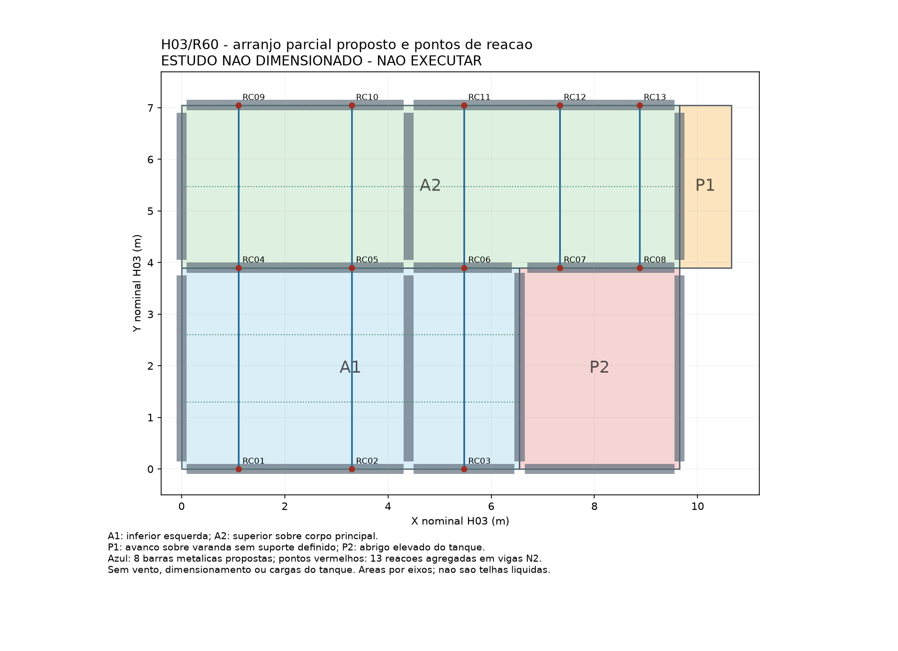

# H03/R60 - arranjo proposto e reacoes parciais da cobertura

ESTUDO NAO DIMENSIONADO - NAO EXECUTAR. Esta etapa define um caminho gravitacional de estudo para duas regioes da cobertura. Nao alterou PRJ/RVT/DWG ou monografia e nao aplicou cargas automaticamente. Usa g=0.330897761 kN/m2 e q_telhado=0.25 kN/m2 da R59; a reserva metalica de 0,15 kN/m2 continua sem levantamento de perfis.

## Leitura geometrica e limites

Revisaram-se a prancha completa, o recorte da planta de cobertura e os contornos vetoriais do PDF. A origem PDF (2040,48;710,36), coordenadas com Y para baixo, foi associada ao encontro nominal (0;0) da H03. Escala 1:100: 28.346456693 pontos/m. Compararam-se cinco eixos de referencia (x6,55/x9,65/x10,65/y3,90/y7,05); residuos inferiores a 5 mm. Trata-se de leitura nominal por eixos centrais de paredes de 15 cm, nao levantamento executivo de faces/beirais/calhas. As areas seguintes sao idealizadas por esses eixos, sem desconto de arremates ou acrescimos de recobrimento.

A1 ocupa x0..6,55/y0..3,90, caimento -Y; A2 ocupa x0..9,65/y3,90..7,05, caimento +Y. Area parcial nominal=55.942500 m2. A agua superior se prolonga ate x10,65 sobre a varanda: P1 possui 3,15 m2 nominais e nao possui viga N2 na borda externa nesse conjunto exportado. O abrigo elevado P2 ocupa x6,55..9,65/y0..3,90, 12,09 m2 nominais, caimento -X. P1 e P2 (15.240000 m2 nominais) permanecem SEM reacoes nativas definidas; cargas desconhecidas nao foram substituidas por zero. Tambem nao se incluiu o policarbonato.

## Hipotese de caminho gravitacional

Propoem-se 3 barras metalicas biapoiadas no sentido Y em A1, e 5 em A2. Cada barra fica no meio da propria faixa tributaria em X, com faixas explicitamente definidas no JSON. A faixa inferior tem vao horizontal3,90m e a superior3,15m; larguras tributarias entre1,55 e2,20m. Terças propostas em A1 nas ordenadas0/1,30/2,60/3,90; em A2,3,90/5,475/7,05. Os perfis e ligacoes nao foram dimensionados. As alturas dos apoios metalicos e a compatibilidade dos perfis sob os planos de telhado continuam pendentes. Nao se declarou viavel construtivamente esse arranjo.

As barras recebem carga vertical uniforme na projecao horizontal. Pela hipotese de dois apoios, cada extremidade transmite g*b*L/2 e q*b*L/2. Adotou-se ausencia de empuxo horizontal apenas no esquema gravitacional idealizado; isto exige detalhar apoio articulado/deslizante e contraventamento. Vento, succao, excentricidade e ancoragens nao estao nesse calculo. Reacoes no mesmo ponto foram somadas: 8 barras resultam em 13 pontos, todos com correspondencia unica nas caixas de vigas N2 dos ramos CAD e BIM. Isso e correspondencia geometrica, nao validacao das ligacoes analiticas locais.

| Ponto | X;Y (m) | G descendente (kN) | Q do telhado (kN) | Viga CAD | Viga BIM |
|---|---:|---:|---:|---|---|
| RC01 | 1.100; 0.000 | 1.419551 | 1.072500 | V1_1 | V4 |
| RC02 | 3.300; 0.000 | 1.419551 | 1.072500 | V1_1 | V4 |
| RC03 | 5.475; 0.000 | 1.387289 | 1.048125 | V3 | V4 |
| RC04 | 1.100; 3.900 | 2.566112 | 1.938750 | V2_1 | V2 |
| RC05 | 3.300; 3.900 | 2.566112 | 1.938750 | V2_1 | V2 |
| RC06 | 5.475; 3.900 | 2.507791 | 1.894687 | V2 | V2 |
| RC07 | 7.325; 3.900 | 0.807804 | 0.610312 | V13_1 | V3 |
| RC08 | 8.875; 3.900 | 0.807804 | 0.610313 | V13_1 | V3 |
| RC09 | 1.100; 7.050 | 1.146561 | 0.866250 | V3_1 | V1 |
| RC10 | 3.300; 7.050 | 1.146561 | 0.866250 | V3_1 | V1 |
| RC11 | 5.475; 7.050 | 1.120503 | 0.846562 | V5_1 | V1 |
| RC12 | 7.325; 7.050 | 0.807804 | 0.610312 | V5_1 | V1 |
| RC13 | 8.875; 7.050 | 0.807804 | 0.610313 | V5_1 | V1 |

Soma G=18.511248005 kN; soma Q_telhado=13.985625000 kN. Conferiram-se equilibrio vertical e primeiros momentos em X/Y das duas acoes, em relacao as areas tributarias parciais. Isso valida a aritmetica do esquema escolhido, nao sua capacidade resistente. Forcas nodais na convencao Fz positiva para cima devem receber sinal negativo para gravidade; confirmar unidades no dialogo do Eberick instalado antes de lancar. Preservar a identificacao por ponto/coordenada/GUID: os nomes BIM V1/V2 aparecem em mais de um solido.

## Aplicacao e continuidade

O mapa e concreto e revisavel para as duas regioes. A aplicacao deve ocorrer em novas copias independentes, com cargas permanentes e variaveis separadas. A simultaneidade com Q_laje=1,00 kN/m2 continua pendente, portanto nao aumentar Q das lajes nem apagar G2_forro=0,25. Registrar cada no/carga introduzido e o tempo, salvar/reabrir e confrontar o acrescimo global com a soma esperada. A discretizacao adicional pertence a mesma concepcao nos dois ramos, sem contar como defeito de transferencia.

O avanco P1 requer suporte/balanco metalico com efeitos locais; o abrigo P2 requer altimetria/apoio independente e nao recebe, por associacao, a carga do reservatorio. Permanecem paredes, platibandas, calhas, tanque1000L/tara/base, escada, bordas, vento/combinacoes e verificacoes ELU/ELS. Preservados os 7 arquivos protegidos R59. A base limpa segue R57 congelada; R58 conserva o diagnostico parcial. Nao se mediu tempo de autoria CAD/BIM nesta R60: o tempo do script exclui pesquisa, decisao e revisao.
