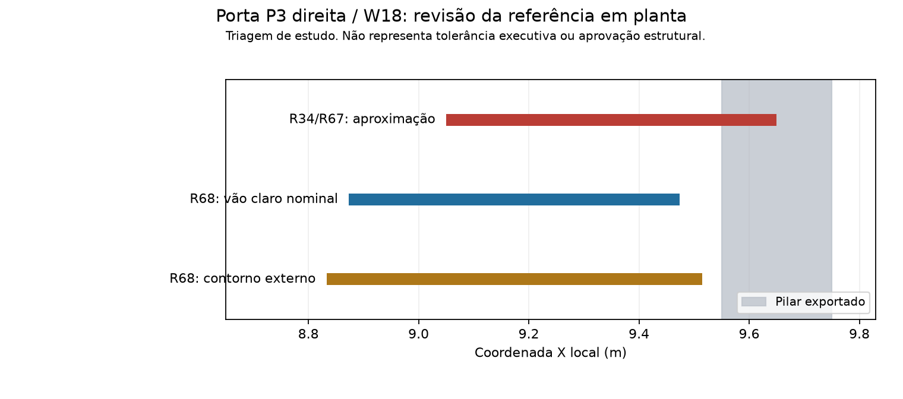

# H03/R68 — conferência vetorial da porta P3 direita

ESTUDO, NÃO EXECUTAR. A sobreposição nominal de10cm indicada na R67 para S-P3-02/W18 foi recalculada após consultar visualmente e extrair os vetores da mesma prancha arquitetônica original. A referência R34 aproximava esse vão por X9,05..9,65m. A conferência mostrou que essa aproximação não deve orientar o deslocamento de um pilar.

Os contornos claros da abertura estão em PDF X1051,44..1085,28pt e os limites externos do conjunto gráfico em1049,04..1087,68pt. As quatro linhas verticais dos dois contornos foram verificadas no arquivo vetorial em Y1273,52..1282,16pt. A transformação usa a origem X548.28pt e escala56.692913386pt/m herdadas R34. O vão claro desenhado mede0.596900m; essa diferença em relação a0,60m decorre da representação gráfica e não foi tratada como medição executiva.

Adotou-se apenas para a referência de estudo a largura nominal0,60m centralizada no intervalo vetorial, resultando em X8.873633..9.473633m. A correção do centro é-0.176367m. Preservaram-se Y nominal3,90m, identificador, etiqueta, demais aberturas e margem de posição±0,05m da triagem. Criou-se nova referência R68; R34/R67 e a prancha original não foram substituídas.

O pilar correspondente possui X9.55..9.75m, com caixas coincidentes CAD/BIM na geometria exportada R56 e preservada R57. A nova referência de vão claro não o intercepta: folga nominal7.64cm e faixa de estudo2.64..12.64cm. Isso retira o conflito nominal do vão claro encontrado pela aproximação anterior. Não prova folga executiva do conjunto: o contorno externo chega a9.514417m, deixando apenas3.56cm nominais; com±5cm de posição, essa faixa ainda permite contato. Esquadria, acabamento e faces reais continuam exigindo compatibilização.

A figura é um esquema derivado de coordenadas, não cópia nem alteração da prancha. Os vetores selecionados e as transformações acompanham o JSON. O recorte visual original ficou apenas em D:/TCC/work. Não se alterou, deslocou ou dimensionou pilar. A ocorrência é revisão de uma referência interpretada manualmente, sem atribuição a defeito DWG/IFC.

As massas condicionais R67 continuam históricas e não são cargas prontas: a parcela nominal de0,10m de vão que intersectava pilar deve ser recalculada antes de qualquer desconto de alvenaria nessa parede. Para0,60m por2,10m, a diferença potencial na retirada geométrica é0,21m², ou0,32865kN na composição hipotética1,565kN/m²; isso não inclui esquadria/verga nem autoriza aplicação de uma carga. As outras dez aberturas não foram refinadas vetorialmente nesta revisão. S-P3-01/W19 permanece outra porta.

Nenhum PRJ/RVT/DWG ou monografia foi editado. Q do telhado e ajuste dos fatores continuam pendentes na interface. Mantém-se a restrição à superestrutura e a necessidade de fechar cargas/combinações e ELU/ELS. O registro do script é somente duração computacional e não tempo do fluxo ou esforço integral da IA.
